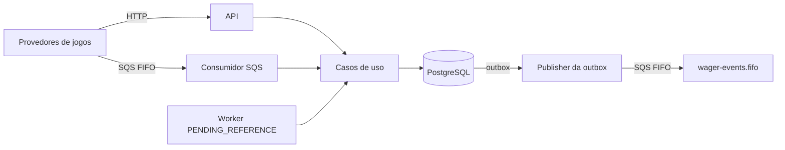

# ARCHITECTURE

## 1. Visão geral



Quatro camadas, com dependências sempre apontando para dentro:

| Camada | Conteúdo | Pode importar |
|---|---|---|
| `domain` | `Money`, `Wallet`, ledger, `WagerTransaction`, inbox, outbox, eventos | nada externo |
| `application` | Casos de uso e portas (interfaces) | `domain` |
| `infrastructure` | SQL, migrations, SQS, log, métricas | `domain`, `application` |
| `interfaces` | HTTP, consumidor SQS, workers | `application` |

Cada processo pode ligar ou desligar publisher, consumidor e worker por variável de ambiente. Todas as instâncias são idênticas e sem estado em memória: o estado vive no PostgreSQL.

## 2. Invariantes

O que nunca pode ser violado, e **onde** cada garantia é imposta:

| Invariante | Imposta por |
|---|---|
| Saldo nunca negativo | `CHECK (balance >= 0)` no banco e checagem no domínio |
| Ledger imutável | Trigger que bloqueia `UPDATE` e `DELETE` |
| Saldo = soma do ledger | Mesma transação grava wallet e lançamento; reconciliação detecta divergência |
| Idempotência | `UNIQUE (provider_id, idempotency_key)` e `UNIQUE (provider_id, external_transaction_id)` |
| Estado terminal não muda | Trigger de transição de estado |
| Uma reversão por transação | Índice único parcial (seção 6) |
| Uma wallet por jogador e moeda | `UNIQUE (player_id, currency)` |

A regra é: se o dinheiro depende disso, o **banco** garante. O código tenta falhar cedo e com mensagem boa, mas um bug na aplicação não consegue corromper os saldos.

## 3. ORM, Money e transações

**MikroORM** é usado só para o pool de conexões e para `em.fork().transactional()`. As operações são SQL explícito (`FOR UPDATE`, `ON CONFLICT DO NOTHING`, `SKIP LOCKED`), sem entidades com decorators. Motivo: em código financeiro eu preciso ver exatamente qual SQL roda e em que ordem os locks são pegos; um mapeador que esconde isso atrapalha.

**Money**: valor decimal com `decimal.js` (precisão 40), nunca `number`. Entrada aceita apenas `^\d+(\.\d{1,2})?$` e moeda `^[A-Z]{3}$`. As colunas são `numeric(19,2)` lidas como `::text`, então o valor nunca passa por ponto flutuante. Na API o dinheiro é sempre string.

**Transação única por mensagem**: wallet, transação de aposta, lançamento no ledger, registro de inbox e mensagens de outbox são gravados na mesma transação de banco. Ou tudo existe, ou nada existe.

## 4. Concorrência

- No começo da transação, `SELECT ... FOR UPDATE` na linha da wallet, **antes** da checagem de idempotência. Duas requisições para a mesma wallet se enfileiram no banco.
- Ordem de locks fixa: wallet, depois transação. Sem lock global; wallets diferentes processam em paralelo.
- Defesa em profundidade: `save(wallet, expectedVersion)` falha se a versão mudou, e o `CHECK` do banco impede saldo negativo mesmo se tudo acima falhar.
- Conflitos de lock transitórios (deadlock, serialização, timeout) viram erro retentável (`503` na API, retry no consumidor).

Por que pessimista e não otimista? Numa carteira "quente" (muitas apostas na mesma wallet), o otimista gera uma tempestade de retries; o `FOR UPDATE` serializa de forma previsível. O custo é throughput por wallet limitado, o que é aceitável: o saldo é intrinsecamente sequencial.

## 5. Idempotência

Duas chaves únicas persistentes. O insert usa `ON CONFLICT DO NOTHING` **sem alvo**, para cobrir as duas.

O hash do payload é SHA-256 do JSON canônico de `providerId`, `externalTransactionId`, `playerId`, `walletId`, `roundId`, `gameId`, `kind`, dinheiro normalizado e `referenceExternalTransactionId`.

| Situação | Resultado |
|---|---|
| Mesma chave, mesmo payload | Replay: devolve o resultado guardado (`resulting_balance` salvo, não o saldo atual), `idempotentReplay: true` |
| Mesma chave, payload diferente | `409` |
| Chave nova, `externalTransactionId` já usado | Tratado como conflito |

Devolver o saldo **gravado** (e não o atual) faz o replay ser realmente idêntico à resposta original.

## 6. Máquina de estados e regras de negócio

```
PENDING ──► PENDING_REFERENCE ──► PROCESSED | REJECTED | FAILED
   │              ▲   │ (pode repetir)
   │              └───┘
   └──────────► PROCESSED | REJECTED | FAILED
```

`PROCESSED`, `REJECTED` e `FAILED` são terminais, e um trigger no banco recusa qualquer saída deles.

| Tipo | Efeito no saldo | Observação |
|---|---|---|
| `BET` | débito | Rejeita se saldo insuficiente |
| `WIN` | crédito | |
| `LOSS` | nenhum | Só registra o resultado da rodada |
| `REFUND`, `ROLLBACK` | estorna a transação referenciada | Exigem `referenceExternalTransactionId` |

**Interpretações que tomei** onde o enunciado deixa margem:

- Reversão (`REFUND` ou `ROLLBACK`) só vale sobre uma transação `PROCESSED` do mesmo provedor, mesmo jogador, mesma moeda e mesmo valor.
- Uma transação só pode ser revertida **uma vez, por qualquer dos dois tipos**: índice único parcial em `reference_transaction_id` onde `status = PROCESSED` e `kind` é `REFUND` ou `ROLLBACK`. Um `REFUND` seguido de um `ROLLBACK` da mesma aposta não debita duas vezes.
- Estornar um `WIN` pode deixar o saldo negativo; nesse caso rejeito com `REVERSAL_WOULD_OVERDRAW` em vez de quebrar o `CHECK`.
- Reversão que chega **antes** da transação original (fora de ordem) não é erro: fica em `PENDING_REFERENCE` (seção 9).

### Códigos de falha

| `failureCode` | Significa | O que o provedor faz |
|---|---|---|
| `INSUFFICIENT_FUNDS` | Saldo menor que a aposta | Não reenviar |
| `REVERSAL_WOULD_OVERDRAW` | Estorno deixaria saldo negativo | Não reenviar; tratar manualmente |
| `REFERENCE_NOT_FOUND` | Referência não apareceu a tempo | Enviar a original e uma nova reversão |
| `REFERENCE_MISMATCH` | Referência de outro jogador, wallet ou provedor | Corrigir o payload |
| `REFERENCE_KIND_NOT_ALLOWED` | Tentou reverter um tipo não reversível | Corrigir o payload |
| `REFERENCE_NOT_PROCESSED` | A referência foi rejeitada ou falhou | Nada a estornar |
| `ALREADY_REVERSED` | Já existe reversão processada | Nada a fazer |
| `CURRENCY_MISMATCH` | Moeda diferente da wallet ou da referência | Corrigir o payload |
| `AMOUNT_MISMATCH` | Valor diferente da referência | Corrigir o payload |
| `PLAYER_MISMATCH` | Jogador não é dono da wallet | Corrigir o payload |
| `INTERNAL_ERROR` | Falha inesperada (status `FAILED`) | Investigar; registrado com correlação |

Rejeição de negócio é **resultado**, não exceção: a transação fica gravada como `REJECTED`, com evento, e um replay devolve a mesma rejeição.

## 7. HTTP

| Status | Quando |
|---|---|
| `200` | Processada ou replay |
| `201` | Wallet criada |
| `202` | `PENDING_REFERENCE` |
| `400` | Entrada inválida |
| `404` | Não encontrada |
| `409` | Conflito de idempotência ou wallet duplicada |
| `422` | Rejeitada por regra de negócio, com `failureCode` |
| `503` | Transitório, com `Retry-After`; reenviar com a mesma chave |
| `500` | Inesperado |

Corpo de erro uniforme: `{ "error": { "code", "message", "retryable" } }`. O campo `retryable` diz ao cliente se vale tentar de novo sem mudar nada.

## 8. Inbox, outbox e eventos

**Inbox** (entrada): cada `messageId` do SQS é registrado na mesma transação do processamento. Redelivery do SQS é inofensivo, porque o efeito já existe.

**Outbox** (saída): os eventos são gravados na mesma transação que muda o saldo, e um publisher separado os envia ao SQS. Isso evita o problema clássico de "gravei no banco mas não consegui publicar" (ou o contrário).

- O publisher lê com `FOR UPDATE SKIP LOCKED`: vários publishers dividem o trabalho sem se bloquear nem enviar o mesmo lote.
- Falhas de envio: backoff exponencial de 1 s, dobrando até 5 min.
- Entrega **at-least-once**. O `eventId` é o `MessageDeduplicationId` (a fila FIFO deduplica reenvios em 5 min) e `aggregateId` (walletId) é o `MessageGroupId`, preservando a ordem por wallet. Consumidores downstream devem ser idempotentes pelo `eventId`.
- Se o publisher morre depois de enviar e antes de marcar como publicado, o evento é reenviado; a deduplicação FIFO e o `eventId` cobrem isso.

A fila de saída `wager-events.fifo` é escolha minha, já que o enunciado não nomeia o destino dos eventos.

## 9. Consumidor SQS

| Resultado do processamento | Ação |
|---|---|
| Sucesso | Commit no banco, **depois** `DeleteMessage` |
| Erro de negócio (rejeição) | Já está gravado; apaga a mensagem |
| Erro permanente (JSON inválido, schema errado) | Envia para a DLQ com o motivo |
| Erro transitório | `ChangeMessageVisibility` (2 s dobrando até 60 s); vai para a DLQ após `SQS_CONSUMER_MAX_ATTEMPTS` (padrão 5) |

A mensagem só é confirmada **depois** do commit. Se o processo morre no meio, a mensagem reaparece e a inbox/idempotência tornam o reprocessamento seguro.

No shutdown, o consumidor termina a mensagem em andamento e devolve as demais (visibilidade 0) para outros consumidores pegarem imediatamente.

## 10. PENDING_REFERENCE

Provedores podem enviar o estorno antes da aposta original. Em vez de rejeitar, a transação espera.

- Até **8 tentativas**, base de 2 s dobrando, teto de 60 s: 2+4+8+16+32+60+60+60 = **242 s** (cerca de 4 minutos) no total.
- A cada tentativa o worker reavalia a referência. Se ela aparece e está `PROCESSED`, aplica o estorno.
- Se esgota o prazo, vira `REJECTED` com `REFERENCE_NOT_FOUND` e emite o evento correspondente.
- O worker usa `SKIP LOCKED`: várias instâncias não disputam a mesma transação.

Por que um worker de polling em vez de reprocessar na chegada da original? É mais simples e robusto: não há acoplamento entre os dois caminhos, e funciona mesmo se a original chegar por outro canal ou outra instância.

## 11. Reconciliação

`POST /wallets/:id/reconciliation` recalcula o saldo a partir do ledger e compara com o saldo gravado. É uma verificação de auditoria, não um mecanismo de correção: se divergir, o sistema reporta e não "conserta" sozinho, porque uma divergência indica bug que precisa ser entendido.

## 12. Observabilidade

- **Logs** em JSON, com apenas campos de correlação (ids, tipo, status, duração). Nunca registram valor monetário nem `playerId`.
- **Métricas** em `/metrics` (texto Prometheus): contadores de transações por tipo e resultado, replays, mensagens SQS por resultado, eventos publicados e falhas; histogramas de duração; gauges de profundidade e idade da outbox, lidos do banco no momento do scrape.
- **Saúde**: `/health/live` (processo) e `/health/ready` (PostgreSQL e SQS).

O gauge de "idade do evento mais antigo não publicado" é o alerta mais útil: se crescer, o publisher parou.

## 13. Testes

- **Unitários**: regras de domínio, hash, política de backoff.
- **Integração**: PostgreSQL e LocalStack reais; constraints, atomicidade, idempotência, outbox, consumidor, API.
- **Concorrência (processos reais)**: 3 instâncias da aplicação disputando as mesmas wallets, consumidores com mensagens duplicadas, `kill -9` no meio da carga, dois publishers dividindo 400 eventos, tomada de posse de um publisher morto, reinício completo.

Todos terminam com a mesma verificação: `balance == soma do ledger` e nenhum saldo negativo.

Limitação conhecida: no Windows o sinal `SIGTERM` não pode ser entregue a um processo filho, então o teste de shutdown gracioso em processo real é ignorado lá. O comportamento do shutdown também é coberto por teste de integração dentro do processo.

## 14. Autenticação

**Não implementada**; deixei o desenho e o ponto de extensão.

- **Mecanismo previsto**: OAuth2/OIDC com Keycloak. O provedor de jogos usaria *client credentials* e enviaria um JWT. A API valida assinatura (JWKS), `iss`, `aud` e expiração.
- **Ponto de extensão**: um `Guard` global do NestJS (`APP_GUARD`). Hoje é o `NoOpAuthGuard`, que sempre permite. Trocar por um guard JWT é substituir uma linha no `AppModule`.
- **Identidade do provedor**: a porta `ProviderIdentityPort` entrega o `providerId` autenticado. O passo seguinte seria **exigir que `providerId` do payload seja igual ao do token**, impedindo que um provedor opere em nome de outro.
- `/health/*` e `/metrics` continuam públicos na rede interna.
- Para o SQS, a autorização é por IAM (quem pode enviar para a fila), não por token.

Enquanto o guard for no-op, qualquer cliente que alcance a API pode operar em qualquer provedor. Isso é aceitável só no escopo do desafio.

## 15. Trade-offs e limitações

| Decisão | Ganho | Custo |
|---|---|---|
| Lock pessimista por wallet | Previsível, sem tempestade de retries | Throughput por wallet é sequencial |
| SQL explícito, sem entidades | Controle total do que roda | Mais código de repositório |
| Outbox at-least-once | Nunca perde evento | Consumidores precisam ser idempotentes |
| Worker de polling para `PENDING_REFERENCE` | Simples e robusto | Latência de até alguns segundos; carga de leitura |
| Rejeição como resultado gravado | Replay idêntico, auditável | Mais linhas no banco |
| Migrations manuais | Deploy controlado | Passo extra no setup |

**Limitações**:

- Sem autenticação (seção 14).
- Sem teste de carga nem dimensionamento de pool sob carga real.
- Uma wallet muito quente é gargalo por construção.
- A ordem global de eventos não é garantida, somente a ordem por wallet.
- A aplicação não roda em contêiner; o Compose sobe só a infraestrutura.
- LocalStack não reproduz todos os comportamentos do SQS real (por exemplo, a janela de deduplicação).

## 16. Próximos passos

1. Guard JWT com Keycloak e checagem `providerId` do token contra o payload.
2. Dockerfile da aplicação e serviço no Compose.
3. Teste de carga (`bun run test:load`) para medir throughput por wallet e dimensionar o pool.
4. Particionamento da tabela de ledger por data.
5. Alertas sobre a idade da outbox e a profundidade da DLQ.